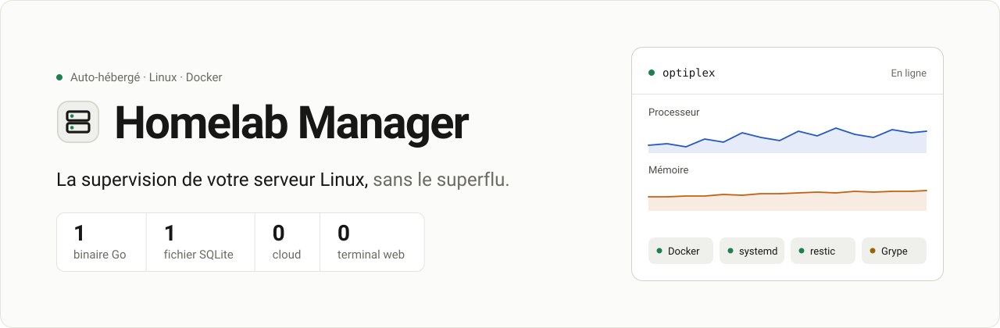

<div align="center">

<picture>
  <source media="(prefers-color-scheme: dark)" srcset=".github/assets/banner-dark.svg">
  
</picture>

<br><br>

[](https://github.com/alexandrebouttierdev/homelab-manager/actions/workflows/ci.yml)
[](https://github.com/alexandrebouttierdev/homelab-manager/actions/workflows/audit.yml)
[](https://github.com/alexandrebouttierdev/homelab-manager/releases/latest)


**[Site](https://alexandrebouttierdev.github.io/homelab-manager/)** · **[Fonctionnalités](#fonctionnalités)** · **[Installation](#installation)** · **[Modules optionnels](#modules-optionnels)** · **[Configuration](#configuration)** · **[Exploitation](#exploitation)** · **[Développement](#développement)** · **[Documentation](#documentation)**

</div>

---

Homelab Manager supervise **une seule machine Linux : celle qui l'héberge**. Il collecte les métriques du système et de Docker, lit le journal et les services systemd, déclenche des alertes, sauvegarde la machine avec restic et recherche les vulnérabilités de ses paquets. Tout tient dans un service systemd et un fichier SQLite ; l'interface est servie sur la même origine que l'API.

<table>
<tr>
<td width="33%" valign="top">


**Léger**

Un binaire statique sans CGO, une base SQLite, aucune dépendance cloud. Installation native Debian 13 et systemd, sans Docker Compose.

</td>
<td width="33%" valign="top">


**Sûr par conception**

Aucun terminal, shell ni SSH dans l'application. Le Manager ne tourne jamais en root ; chaque action privilégiée passe par polkit et une liste blanche.

</td>
<td width="33%" valign="top">


**Honnête**

Aucune valeur inventée : une donnée absente s'affiche comme indisponible, un module dont l'outil manque le dit, et le reste fonctionne.

</td>
</tr>
</table>

> Les applications PaaS et le déploiement GitOps restent confiés à [Coolify](https://coolify.io/) : Homelab Manager ne les gère pas.

## Fonctionnalités

### 📊 Supervision

- **Tableau de bord** : CPU, mémoire, swap, stockage, réseau, températures réellement disponibles, synthèse des vulnérabilités.
- **Historiques** bruts ou agrégés (1 min, 5 min, 1 h), rétention réglable de 1 à 365 jours (7 par défaut).
- **Événements** : création, suppression, redémarrage et changement d'état des conteneurs, échec et rétablissement des services.

### 🐳 Docker

- Découverte continue des conteneurs, arrêtés compris, avec leurs métriques.
- Inventaire en lecture seule des images, volumes et réseaux, y compris inutilisés.
- **Journal de chaque conteneur** : stdout et stderr, filtre, relecture toutes les 5 s.
- *Optionnel* : démarrer, arrêter et redémarrer un conteneur.

### ⚙️ Système

- **Journal systemd** en lecture seule : filtres, recherche, suivi en direct, synthèse sur 24 h, export, champs sensibles masqués.
- **Services, timers et sockets** systemd (D-Bus) : états, ressources, détail, événements d'échec.
- **Tâches planifiées** : crontabs du système, scripts `run-parts` et timers, traduits en français, avec leurs prochaines et dernières exécutions.
- *Optionnel* : actions sur une liste blanche d'unités, nettoyage planifié du journal, nom de la machine, fuseau et langue, redémarrage et extinction.

### 🔔 Alertes et notifications

- Règles sur les métriques, les conteneurs, les unités en échec, les collecteurs, les sauvegardes et les vulnérabilités, évaluées toutes les 15 s.
- Cycle de vie complet : déclenchement, acquittement, résolution, historique, indicateurs, silences.
- Canaux **Telegram, Discord, Gotify, ntfy, e-mail (SMTP) et webhook signé** HMAC-SHA256, avec regroupement et renotification.

### 💾 Sauvegardes (restic)

- Dépôt chiffré local, rest-server, S3 (dont Backblaze B2) ou SFTP ; dépôt de copie pour la règle 3-2-1.
- Sauvegardes planifiées et manuelles, copie cohérente de bases SQLite avant chaque sauvegarde.
- Rétention, vérification hebdomadaire, comparaison d'instantanés.
- Restauration en quarantaine ou, après simulation, à l'emplacement d'origine ; archive `.tar.gz` téléchargeable.

### 🛡️ Vulnérabilités

- Analyse des paquets système par [Grype](https://github.com/anchore/grype), dans une unité dédiée : Debian, Ubuntu, Alpine, Fedora, RHEL, Rocky Linux et AlmaLinux 9 et suivantes.
- Scans quotidiens et à la demande, historique, nouvelles et disparues entre deux scans, règle d'alerte.

### 👥 Comptes et sécurité

- Comptes multiples avec rôles `viewer`, `operator`, `admin` ; mot de passe initial à changer, réinitialisation par un administrateur.
- **Double authentification** : application TOTP, passkeys et clés FIDO2 (WebAuthn), codes de secours ; exigible des administrateurs ; connexion par passkey seule si la politique l'autorise.
- Sessions consultables et révocables, expiration après inactivité, verrouillage après 5 échecs, réseaux autorisés (CIDR).
- **Journal d'audit** filtrable, export CSV et JSON.
- **Jetons d'API** en lecture ou en action, pour Home Assistant, Grafana ou vos scripts.

## Installation

### Prérequis

| | |
|---|---|
| **Système** | Linux avec systemd, `amd64` ou `arm64`. Testé sur **Debian 13** |
| **Docker** | Docker Engine, pour la supervision des conteneurs (sans lui, la collecte Docker est indisponible et le reste fonctionne) |
| **Disque** | ≈ 300 Mo par jour d'historique à l'intervalle par défaut, soit ≈ 2 Go pour 7 jours de rétention ; ≈ 3,5 Go de plus pour la base de Grype si le module Vulnérabilités est installé |
| **Modules optionnels** | `polkitd`, et selon le module `restic`, `grype`, `openssh-client` (voir [Modules optionnels](#modules-optionnels)) |

### 1. Obtenir l'archive

Chaque archive contient, pour une architecture, les trois binaires statiques (`homelab-manager`, `homelab-docker-proxy`, `homelab-backup-runner`), l'interface compilée, les unités systemd, la configuration et les règles polkit. Deux façons de l'obtenir :

<details open>
<summary><b>Depuis une release GitHub</b> (recommandé)</summary>

<br>

```bash
VERSION=2.3.0   # numéro de la release choisie, sans le « v »
ARCH=amd64      # ou arm64 (Raspberry Pi 4/5, Mac Apple Silicon…)
BASE=https://github.com/alexandrebouttierdev/homelab-manager/releases/download/v$VERSION
curl -fsSLO "$BASE/homelab-manager_${VERSION}_linux_${ARCH}.tar.gz"
curl -fsSLO "$BASE/SHA256SUMS"
sha256sum -c --ignore-missing SHA256SUMS
tar -xzf "homelab-manager_${VERSION}_linux_${ARCH}.tar.gz"
cd "homelab-manager_${VERSION}_linux_${ARCH}"
```

Avec la [CLI GitHub](https://cli.github.com/), une fois connecté (`gh auth login`), les deux `curl` deviennent : `gh release download "v$VERSION" -R alexandrebouttierdev/homelab-manager -p "homelab-manager_${VERSION}_linux_${ARCH}.tar.gz" -p SHA256SUMS`.

</details>

<details>
<summary><b>Depuis les sources</b> (Go 1.26.11 et Node.js 22)</summary>

<br>

Sur un poste de développement, construire les mêmes archives qu'une release, puis les copier sur la machine :

```bash
git clone https://github.com/alexandrebouttierdev/homelab-manager.git
cd homelab-manager
npm --prefix frontend ci
scripts/release/build.sh 2.3.0 dist     # archives amd64 et arm64 + SHA256SUMS dans dist/
scp dist/homelab-manager_2.3.0_linux_amd64.tar.gz machine:
```

Sur la machine : `tar -xzf homelab-manager_2.3.0_linux_amd64.tar.gz && cd homelab-manager_2.3.0_linux_amd64`.

</details>

Les commandes suivantes se lancent depuis le répertoire extrait.

### 2. Créer les comptes système

Le Manager n'est **pas** membre du groupe `docker` : seul le proxy restreint l'est.

```bash
sudo adduser --system --group --no-create-home homelab-manager
sudo adduser --system --group --no-create-home homelab-docker-proxy
sudo usermod -aG docker homelab-docker-proxy   # seulement si Docker est installé
```

### 3. Installer les fichiers

```bash
sudo install -m 0755 bin/homelab-manager bin/homelab-docker-proxy bin/homelab-backup-runner /usr/local/bin/
sudo mkdir -p /opt/homelab-manager/frontend /etc/homelab-manager
sudo cp -R frontend/dist /opt/homelab-manager/frontend/
sudo install -m 0644 deployments/config/manager.yaml /etc/homelab-manager/manager.yaml
sudo install -m 0644 deployments/systemd/*.service deployments/systemd/*.socket /etc/systemd/system/
```

Les secrets éventuels (`HOMELAB_ADMIN_PASSWORD`, …) vont dans `/etc/homelab-manager/manager.env`, en mode `0600`.

### 4. Créer la clé du coffre de secrets

Elle chiffre les secrets TOTP, les jetons des canaux de notification et les mots de passe des dépôts de sauvegarde. 32 octets aléatoires, chiffrés par `systemd-creds` avec le TPM 2.0 de la machine s'il existe, sinon avec la clé de l'hôte ; l'unité les importe au démarrage et seul le service peut les lire.

```bash
sudo mkdir -p /etc/credstore.encrypted
head -c 32 /dev/urandom | base64 | sudo systemd-creds encrypt \
  --name=homelab-manager-secrets-key - /etc/credstore.encrypted/homelab-manager-secrets-key
```

> [!NOTE]
> Sans cette clé, le Manager démarre quand même et la supervision fonctionne, mais la double authentification par application, les canaux à secret et les sauvegardes sont indisponibles. Le journal du service l'indique au démarrage (« No secrets key configured »).

<details>
<summary><b>Conteneur LXC (Proxmox, OrbStack…) : la clé n'est pas chargée</b></summary>

<br>

Dans un conteneur système LXC, systemd peut désactiver l'import des secrets chiffrés (`ImportCredential=` vidé par `/run/systemd/system/service.d/zzz-lxc-service.conf`) : le journal indique alors « No secrets key configured » malgré l'étape ci-dessus. Utiliser à la place un fichier de clé lisible par le seul service :

```bash
head -c 32 /dev/urandom | base64 | sudo install -m 0400 -o homelab-manager -g homelab-manager /dev/stdin /etc/homelab-manager/secrets.key
echo "HOMELAB_SECRETS_KEY_FILE=/etc/homelab-manager/secrets.key" | sudo tee -a /etc/homelab-manager/manager.env
sudo chmod 0600 /etc/homelab-manager/manager.env
sudo systemctl restart homelab-manager   # le journal indique « Secrets key loaded »
```

La clé n'est alors protégée que par les droits du fichier, pas par le TPM. Ce même fichier systemd allège aussi le cloisonnement des services (`ProtectSystem`, `NoNewPrivileges`…) : une machine virtuelle ou une installation directe isole mieux le Manager.

</details>

### 5. Démarrer

```bash
sudo systemctl daemon-reload
sudo systemctl enable --now homelab-docker-proxy.socket homelab-manager.service
journalctl -u homelab-manager -n 20   # la version démarrée y est journalisée
```

### 6. Se connecter

Ouvrir `http://<machine>:8080`. Sans `HOMELAB_ADMIN_PASSWORD`, le premier compte est `admin` / `admin` et **l'interface impose d'en choisir un autre dès la première connexion**. Activer ensuite la double authentification dans « Configuration ».

> [!TIP]
> **HTTPS** : renseigner `tls_cert_file` et `tls_key_file` dans `manager.yaml` (fichiers lisibles par le compte `homelab-manager`), ou placer le Manager derrière un proxy inverse et mettre `HOMELAB_SESSION_SECURE=true`. HTTPS et un nom de domaine sont indispensables aux passkeys.

### Mettre à jour

1. [Sauvegarder la base](#sauvegarder-la-base-du-manager).
2. Arrêter `homelab-manager.service`.
3. Remplacer les binaires, `/opt/homelab-manager/frontend/dist` et, si le README de la version l'indique, les unités, `tmpfiles.d` et règles polkit des modules installés.
4. `sudo systemctl daemon-reload && sudo systemctl start homelab-manager`. Les migrations SQLite s'appliquent seules au démarrage.

## Modules optionnels

Les fonctions qui demandent un privilège sont **désactivées par défaut**. Chacune s'active séparément : une règle polkit qui n'autorise qu'elle, et le plus souvent un réglage de `manager.yaml`.

| Module | Ce qu'il permet | Rôle requis | À installer |
|---|---|---|---|
| [Actions sur les services](#actions-sur-les-services) | Démarrer, arrêter, redémarrer, recharger des unités listées | `operator` | Règle polkit générée |
| [Actions sur les conteneurs](#actions-sur-les-conteneurs) | Démarrer, arrêter, redémarrer un conteneur | `operator` | Deux réglages |
| [Sauvegardes](#sauvegardes-restic) | Sauvegarder et restaurer avec restic | `admin` (`operator` pour lancer) | `restic`, règle polkit |
| [Vulnérabilités](#vulnérabilités-grype) | Analyser les paquets avec Grype | `operator` pour lancer | `grype`, unité, règle polkit |
| [Maintenance](#nettoyage-planifié-du-journal) | Nettoyer le journal systemd selon un horaire | `admin` | Unité, règle polkit |
| [Préférences système](#nom-de-la-machine-fuseau-et-langue) | Nom de la machine, fuseau, langue | `admin` | Règle polkit, réglage |
| [Alimentation](#redémarrer-et-éteindre) | Redémarrer et éteindre la machine | `admin` | Règle polkit, réglage |

`polkitd` est nécessaire à tous : `sudo apt install polkitd`. Les commandes ci-dessous se lancent depuis le répertoire de l'archive.

### Actions sur les services

Les opérateurs et les administrateurs démarrent, arrêtent, redémarrent ou rechargent les seules unités listées dans `systemd_manageable_units` (vide par défaut, 200 au plus), et « Exécutent » un timer dont le service est listé. Une alerte « unité en échec » propose aussi « Redémarrer ».

```bash
sudoedit /etc/homelab-manager/manager.yaml   # systemd_manageable_units: [nginx.service, backup.service]
sudo /usr/local/bin/homelab-manager polkit-rule > 50-homelab-manager.rules
sudo install -o root -g root -m 0644 50-homelab-manager.rules /etc/polkit-1/rules.d/
sudo systemctl restart homelab-manager
```

<details>
<summary>Détails et précautions</summary>

<br>

- `homelab-manager polkit-rule` lit la même configuration que le service et écrit la règle correspondante : `org.freedesktop.systemd1.manage-units` pour le seul compte `homelab-manager`, sur les seules unités listées, avec les seuls verbes `start`, `stop`, `restart` et `reload`. Sans elle, les actions échouent avec « polkit a refusé ».
- Régénérer et réinstaller la règle après chaque changement de la liste. La placer dans `manager.yaml` : la commande ne lit pas le fichier d'environnement du service.
- Chaque nom suit le motif `nom.service`, `nom.timer` ou `nom.socket` (instances `nom@instance.service` acceptées, modèles `nom@.service` refusés) ; un nom invalide empêche le démarrage.
- Chaque action est confirmée, auditée, suivie jusqu'à un état stable (90 s au plus) ; une seule à la fois par unité, 30 par minute et par utilisateur.
- Rien d'autre n'est possible : ni activer, désactiver ou masquer une unité, ni `daemon-reload`, ni tuer un processus.
- Ne lister que des unités dont l'arrêt est acceptable : lister `homelab-manager.service` permettrait à un opérateur d'arrêter le Manager.

</details>

### Actions sur les conteneurs

Le journal des conteneurs est toujours disponible ; démarrer, arrêter et redémarrer demandent deux autorisations, celle du proxy puis celle du Manager :

```bash
sudo systemctl edit homelab-docker-proxy.service
```

```ini
[Service]
Environment=HOMELAB_DOCKER_PROXY_CONTAINER_ACTIONS=true
```

Puis mettre `docker_actions_enabled: true` dans `/etc/homelab-manager/manager.yaml` et redémarrer `homelab-docker-proxy.service` et `homelab-manager.service`. Chaque action est confirmée, auditée et limitée à 30 par minute et par utilisateur. Supprimer un conteneur, `exec`, `kill` et le nettoyage restent impossibles.

### Sauvegardes (restic)

Le Manager sauvegarde les chemins choisis par un administrateur (par exemple `/etc`, `/var/lib/docker/volumes`, `/opt/stacks`) dans un dépôt [restic](https://restic.net/) chiffré. restic ne tourne jamais dans le Manager : l'unité root dédiée `homelab-backup@.service` lance `homelab-backup-runner`, qui relit et valide le travail écrit par le Manager puis exécute restic sans shell, avec une priorité basse et 6 heures au plus.

```bash
sudo apt install restic
sudo install -m 0644 deployments/tmpfiles/homelab-backup.conf /etc/tmpfiles.d/
sudo systemd-tmpfiles --create homelab-backup.conf
sudo install -o root -g root -m 0644 deployments/polkit/50-homelab-manager-backup.rules /etc/polkit-1/rules.d/
sudo install -D -o root -g root -m 0644 "deployments/systemd/homelab-backup@restore-in-place.service.d/50-in-place.conf" \
  "/etc/systemd/system/homelab-backup@restore-in-place.service.d/50-in-place.conf"
sudo systemctl daemon-reload && sudo systemctl restart homelab-manager
```

Ensuite, dans « Sauvegardes » › « Configuration » : choisir le dépôt, les sources, les exclusions et l'horaire (quotidien ou hebdomadaire), enregistrer, puis « Initialiser le dépôt ».

> [!IMPORTANT]
> Le mot de passe du dépôt est généré par le Manager et affiché **une seule fois**. Conservez-le hors ligne : sans lui, aucune restauration n'est possible si la machine est perdue.

<details>
<summary>Dépôts, sources et bases SQLite</summary>

<br>

- **Dépôt local** : sous `/mnt`, `/media`, `/srv` ou `/var/backups`, seuls emplacements où l'unité peut écrire (disque USB, partage NFS ou SMB déjà monté par le système) ; ailleurs, ajouter `ReadWritePaths=` par `sudo systemctl edit homelab-backup@.service`.
- **rest-server** en HTTPS, ou **bucket S3** compatible (dont Backblaze B2).
- Le mot de passe et les clés d'accès sont scellés par le coffre de secrets : sans clé du coffre, les sauvegardes sont indisponibles.
- Un administrateur du Manager peut sauvegarder n'importe quel fichier de la machine vers le dépôt choisi : réservez ce rôle en conséquence.
- **Rattacher un dépôt existant** (réinstallation, autre machine) : enregistrer son emplacement puis saisir son mot de passe dans la carte « Initialiser le dépôt ».
- **Bases SQLite** : « Bases SQLite à copier avant la sauvegarde » liste des fichiers de base (par exemple `/var/lib/docker/volumes/vaultwarden/_data/db.sqlite3`, 20 au plus). Avant chaque sauvegarde, chacune est copiée de façon cohérente pendant que l'application tourne ; la copie, vérifiée, est sauvegardée sous `/var/lib/homelab-backup/dumps/` au chemin de la base. Restaurer cette copie plutôt que le fichier lui-même, qui peut avoir été saisi au milieu d'une écriture. Une base en mode WAL dont le répertoire n'est pas accessible en écriture à l'unité peut ne pas pouvoir être copiée : ajouter son répertoire par `sudo systemctl edit homelab-backup@.service` (`[Service]` puis `ReadWritePaths=/var/lib/docker/volumes`). Une copie impossible termine la sauvegarde en avertissement.
- La planification est tenue par le Manager, qui rattrape une fois au redémarrage une sauvegarde manquée pendant un arrêt. Les opérateurs lancent une sauvegarde à la demande.

</details>

<details>
<summary>Dépôt SFTP</summary>

<br>

Le dépôt principal comme le dépôt de copie peuvent être un répertoire d'un serveur SSH : `sftp://utilisateur@hôte[:port]/chemin/absolu`. Installer le client : `sudo apt install openssh-client`.

1. Le Manager n'utilise pas la clé SSH de root : la carte « Clé SSH du Manager », qui apparaît quand on choisit SFTP, génère sa propre clé (« Générer la clé SSH »).
2. Sur le serveur, ajouter la clé publique affichée au fichier `~/.ssh/authorized_keys` du compte indiqué dans l'adresse. Un compte dédié limité à SFTP est préférable, par exemple dans `/etc/ssh/sshd_config` du serveur :

   ```text
   Match User backup
       ForceCommand internal-sftp
       AllowTcpForwarding no
       X11Forwarding no
   ```

3. Coller la clé d'hôte du serveur dans « Clé d'hôte du serveur » : le contenu de `/etc/ssh/ssh_host_ed25519_key.pub` **lu sur le serveur lui-même** (ou une ligne de `ssh-keyscan -t ed25519 hôte`, à comparer à l'empreinte que donne `ssh-keygen -lf /etc/ssh/ssh_host_ed25519_key.pub` sur le serveur).

Le Manager refuse tout serveur qui présente une autre clé ; si la clé du serveur change (réinstallation), collez la nouvelle, le dépôt reste initialisé. « Remplacer la clé » génère une nouvelle clé SSH du Manager : installez-la sur chaque serveur, l'ancienne ne sert plus.

</details>

<details>
<summary>Rétention, vérification et dépôt de copie</summary>

<br>

- **Rétention** (par défaut 7 quotidiens, 4 hebdomadaires, 6 mensuels, désactivée) : supprime les instantanés au-delà de la politique après chaque sauvegarde planifiée réussie.
- **Vérification** : relit 5 % des données au plus une fois par semaine.
- Les deux se lancent aussi depuis la carte « Maintenance », avec « Forcer le déverrouillage » pour un dépôt resté verrouillé par une opération interrompue (à éviter si un autre programme utilise le dépôt).
- **Dépôt de copie (règle 3-2-1)** : la carte « Dépôt de copie » définit un second dépôt (local, rest-server, S3 ou SFTP), de préférence hors de la machine. « Créer le dépôt de copie » le crée avec les paramètres de découpage du dépôt principal et y copie les instantanés ; son mot de passe, distinct, est affiché **une seule fois**. Ensuite, « Copier maintenant », ou une copie automatique après chaque sauvegarde planifiée réussie ; la rétention s'applique aussi à la copie. Deux dépôts S3 doivent partager la même clé d'accès (restic n'en lit qu'une pour une copie).

</details>

<details>
<summary>Restaurer, comparer, télécharger</summary>

<br>

- **En quarantaine** : dans « Instantanés », un administrateur choisit un instantané et, au besoin, des chemins, simule puis restaure. Les fichiers arrivent dans `/var/lib/homelab-backup/restore/<identifiant>/`, accessible à root seulement : les recopier ensuite à la main (`sudo cp -a …`) et supprimer le répertoire.
- **À l'emplacement d'origine** : remet des chemins nommés en place, après une simulation réussie des mêmes chemins (moins de 30 minutes) et une case de confirmation. L'état actuel de ces chemins est d'abord sauvegardé (instantané `before-restore`, pour revenir en arrière) ; seuls les fichiers différents sont remplacés et rien n'est supprimé. `/`, `/etc`, `/usr`, `/boot` et les données du Manager se restaurent toujours par la quarantaine.
- **Comparer** : cocher deux instantanés puis « Comparer » liste ce qui a été ajouté, supprimé ou modifié (les 1 000 premiers chemins, filtrables ; les autres rôles n'en voient que les chiffres).
- **Archive** : « Préparer l'archive » produit un `.tar.gz` d'un chemin de l'instantané (4 Gio au plus), téléchargeable par un administrateur pendant 24 heures. L'archive n'est pas chiffrée.

</details>

### Vulnérabilités (Grype)

Le Manager lit lui-même la liste des paquets, puis la fait analyser par l'unité dédiée `homelab-vulnscan.service`. Grype ne tourne jamais dans le Manager : il s'exécute sous son propre compte, avec des commandes fixes, une priorité minimale, 1 Gio de mémoire et 15 minutes au plus. Un scan a lieu 2 minutes après le premier démarrage, puis toutes les 24 heures (`vulnerability_scan_interval_hours`, de 6 à 168), et à la demande.

Grype n'est pas dans les dépôts Debian : paquet officiel d'Anchore, version figée **0.121.3**.

```bash
GRYPE_VERSION=0.121.3
ARCH=amd64   # ou arm64
BASE=https://github.com/anchore/grype/releases/download/v$GRYPE_VERSION
curl -fsSLO "$BASE/grype_${GRYPE_VERSION}_linux_${ARCH}.deb"
curl -fsSLO "$BASE/grype_${GRYPE_VERSION}_checksums.txt"
curl -fsSLO "$BASE/grype_${GRYPE_VERSION}_checksums.txt.sigstore.json"
# Signature des sommes (cosign, facultatif mais recommandé), puis somme du paquet :
cosign verify-blob "grype_${GRYPE_VERSION}_checksums.txt" \
  --bundle "grype_${GRYPE_VERSION}_checksums.txt.sigstore.json" \
  --certificate-identity-regexp '^https://github.com/anchore/grype/' \
  --certificate-oidc-issuer https://token.actions.githubusercontent.com
sha256sum -c --ignore-missing "grype_${GRYPE_VERSION}_checksums.txt"
sudo apt install "./grype_${GRYPE_VERSION}_linux_${ARCH}.deb"

# Compte de l'unité, répertoires d'échange, règle polkit (start de cette seule unité)
sudo adduser --system --group --no-create-home homelab-vulnscan
sudo install -m 0644 deployments/tmpfiles/homelab-vulnscan.conf /etc/tmpfiles.d/
sudo systemd-tmpfiles --create /etc/tmpfiles.d/homelab-vulnscan.conf
sudo install -o root -g root -m 0644 deployments/polkit/50-homelab-manager-vulnscan.rules /etc/polkit-1/rules.d/
sudo install -m 0644 deployments/systemd/homelab-vulnscan.service /etc/systemd/system/
sudo systemctl daemon-reload
sudo systemctl restart homelab-manager.service   # prend en compte ReadWritePaths=
```

<details>
<summary>Base de Grype, machine hors ligne et dépannage</summary>

<br>

- L'unité télécharge la base de Grype depuis `grype.anchore.io` avant un scan quand une base plus récente est publiée (une par jour) : environ 200 Mo compressés, **3,4 Go une fois décompressée** dans `/var/cache/homelab-vulnscan` (mesuré le 25 novembre 2026). Le premier scan dure donc quelques minutes, les suivants quelques secondes. Une base de plus de 5 jours fait échouer le scan plutôt que donner un résultat trompeur.
- **Sans accès à Internet** : désactiver ce téléchargement (`sudo systemctl edit homelab-vulnscan.service`, puis `Environment=GRYPE_DB_AUTO_UPDATE=false` sous `[Service]`) et importer une base à la main : `sudo -u homelab-vulnscan env GRYPE_DB_CACHE_DIR=/var/cache/homelab-vulnscan/db grype db import <archive>`.
- Un scan en échec indique sa cause (Grype ou unité absents, règle polkit absente, délai dépassé, base injoignable ou périmée) ; le détail est dans `journalctl -u homelab-vulnscan`.
- Une base RPM Berkeley DB (RHEL 8 et dérivées) est signalée non prise en charge. Les dépendances embarquées dans des binaires ou des images Docker sont hors périmètre.
- Une vulnérabilité listée est connue pour la version installée, pas forcément exploitable sur la machine.

</details>

### Nettoyage planifié du journal

L'onglet « Maintenance » de la page « Tâches planifiées » planifie des tâches prédéfinies, sans commande saisie. La première, « Nettoyage du journal système », garde le journal systemd sous 256 Mio, 512 Mio, 1 Gio ou 2 Gio, chaque jour ou chaque semaine à l'heure choisie, ou à la demande.

```bash
sudo install -o root -g root -m 0644 "deployments/systemd/homelab-journal-vacuum@.service" /etc/systemd/system/
sudo install -o root -g root -m 0644 deployments/polkit/50-homelab-manager-maintenance.rules /etc/polkit-1/rules.d/
sudo systemctl daemon-reload
```

### Nom de la machine, fuseau et langue

La carte « Préférences système » des Paramètres les affiche à tous ; seuls les administrateurs les changent.

```bash
sudo install -o root -g root -m 0644 deployments/polkit/50-homelab-manager-system.rules /etc/polkit-1/rules.d/
```

Puis mettre `system_preferences_enabled: true` dans `/etc/homelab-manager/manager.yaml` et redémarrer `homelab-manager.service`. Un fuseau inconnu ou une langue non installée (`locale-gen`) sont refusés par le système.

> [!WARNING]
> Changer le nom de la machine peut casser les adresses qui utilisent l'ancien (DNS local, mDNS, certificat TLS). Sur Debian, la langue reste en lecture seule : Debian interdit à systemd de la changer (`systemd-localed-read-only.conf`) ; utiliser `sudo dpkg-reconfigure locales`.

### Redémarrer et éteindre

```bash
sudo install -o root -g root -m 0644 deployments/polkit/50-homelab-manager-power.rules /etc/polkit-1/rules.d/
```

Puis mettre `power_actions_enabled: true` dans `/etc/homelab-manager/manager.yaml` et redémarrer `homelab-manager.service`. La règle n'autorise que le redémarrage et l'extinction, par le seul compte `homelab-manager`, et respecte les verrous d'inhibition. Seuls les administrateurs voient la carte « Alimentation » de la page Machine ; la confirmation demande de saisir le nom de la machine. Après une extinction, il faut un accès physique (ou Wake-on-LAN configuré hors de Homelab Manager) pour rallumer la machine.

## Guide d'utilisation

<details>
<summary><b>🔔 Alertes et notifications</b></summary>

<br>

La page « Alertes » montre les alertes ouvertes (les plus graves d'abord, avec un lien vers l'unité, le conteneur ou les métriques en cause), l'historique et des indicateurs sur 24 heures. Les règles sont évaluées toutes les 15 secondes sur les données déjà collectées, sans requête externe.

**Règles fournies** (modifiables et désactivables, pas supprimables) : disque utilisé à plus de 85 %, mémoire disponible sous 10 %, température au-dessus de 85 °C (seuil fixe : les seuils des capteurs ne sont pas collectés), collecte système ou Docker indisponible depuis 2 minutes, unité systemd en échec, sauvegarde en retard (aucune réussie depuis 26 heures) ou en échec. Un administrateur ajoute ses propres règles ; un opérateur ou un administrateur acquitte une alerte, qui reste ouverte jusqu'à sa résolution. Une source illisible (Docker arrêté, systemd injoignable) ne déclenche ni ne résout les règles qui en dépendent.

**Canaux** (onglet « Canaux », administrateurs) : Telegram, Discord, Gotify, ntfy, e-mail (SMTP avec STARTTLS ou TLS) et webhook JSON signé en HMAC-SHA256 (format et vérification : [docs/API_CONTRACTS.md](docs/API_CONTRACTS.md) § 4.8). Chaque canal a une sévérité minimale et une renotification (toutes les 30 minutes par défaut) tant que l'alerte n'est pas acquittée ; il reçoit au plus un message par minute, qui regroupe les événements arrivés entre-temps. « Tester » envoie un message aussitôt. Les jetons et mots de passe sont chiffrés par le coffre et jamais réaffichés : sans clé, seuls les canaux sans secret (ntfy public, webhook non signé) fonctionnent. Ces envois sont la seule communication sortante du Manager ; un échec n'est pas réessayé et n'affecte pas la supervision.

**Silences** : depuis une alerte (sur sa cible ou toute sa règle) ou globalement depuis l'onglet « Silences », de 15 minutes à 7 jours, avec un motif. Les alertes sous silence restent visibles ; seules leurs notifications sont suspendues.

</details>

<details>
<summary><b>🔑 Double authentification et passkeys</b></summary>

<br>

**Application TOTP** : dans « Configuration » › Double authentification, saisir le mot de passe actuel, scanner le QR code (Aegis, Google Authenticator, 1Password…), entrer un premier code, puis conserver les 10 codes de secours affichés une seule fois.

**Passkeys et clés de sécurité** : « Ajouter une clé » enregistre une clé FIDO2 (YubiKey…) ou une passkey du téléphone ou de l'ordinateur ; jusqu'à 10 clés par compte. La clé doit vérifier l'utilisateur (PIN, empreinte, visage). Si la politique de sécurité l'autorise, la page de connexion propose aussi « Se connecter avec une passkey », sans identifiant ni mot de passe (désactivé par défaut). Il faut un nom de domaine et HTTPS (le navigateur refuse WebAuthn sur une adresse IP ou en HTTP, sauf `localhost`) :

```yaml
webauthn_rp_id: "homelab.example"
webauthn_origins: ["https://homelab.example:8080"]
```

Changer de domaine rend les clés enregistrées inutilisables : se connecter avec l'application ou un code de secours, puis les réenregistrer.

**Obligation** : dans « Utilisateurs & accès » › Politique, un administrateur qui l'a lui-même activée peut l'exiger de tous les administrateurs.

En cas d'appareil perdu, voir [Récupérer un accès](#récupérer-un-accès).

</details>

<details>
<summary><b>🤖 Jetons d'API</b></summary>

<br>

Dans les Paramètres, carte « Jetons d'API », chaque compte crée des jetons pour ses scripts ou tableaux de bord : nom, portées en lecture (métriques, conteneurs, événements, services, sauvegardes), portées d'action pour les opérateurs et administrateurs (services de la liste blanche, conteneurs) et validité de 1 à 365 jours. Le jeton (`hlm_…`) s'affiche une seule fois.

```bash
curl -H "Authorization: Bearer hlm_…" https://homelab.lan:8080/api/v1/dashboard
```

Un jeton d'action redémarre par exemple un service depuis Home Assistant :

```bash
curl -X POST -H "Authorization: Bearer hlm_…" -H "Content-Type: application/json" \
  -d '{"action":"restart"}' https://homelab.lan:8080/api/v1/system/units/nginx.service/actions
```

Un jeton n'agit que dans les limites du rôle de son compte, et chaque action est inscrite au journal d'audit avec le jeton. Il ne donne jamais accès aux comptes, aux paramètres ni à l'audit, et cesse de fonctionner à son expiration, à sa révocation ou si le compte est désactivé. Un administrateur voit et révoque les jetons de tous les comptes.

</details>

<details>
<summary><b>📜 Journaux, services et tâches planifiées</b></summary>

<br>

- **Journaux système** : lus par `journalctl`, en lecture seule, pour tous les rôles. L'unité fournie ajoute le groupe `systemd-journal` au service : sans lui, le Manager ne voit que ses propres entrées et la page l'indique. Chaque appel est limité à 10 secondes, sans shell ni variables d'environnement. `_CMDLINE` et les champs dont le nom contient `PASSWORD`, `TOKEN` ou `SECRET` sont masqués ; un secret écrit dans le texte d'un message reste visible, comme dans `journalctl`. L'export est limité aux 50 000 entrées les plus récentes du filtre.
- **Services système** : lus sur le bus D-Bus, sans privilège, toutes les 30 secondes, sans `systemctl`. Une unité qui passe en échec crée un événement `service.failed`, son retour à l'état actif un événement `service.recovered`, une seule fois même après un redémarrage du Manager. Sans bus système (hors Linux, conteneur), la page l'indique.
- **Tâches planifiées** : `/etc/crontab`, `/etc/cron.d`, les scripts de `/etc/cron.{hourly,daily,weekly,monthly}` et les timers systemd, avec leur planification en français, leurs cinq prochaines exécutions et leur dernière exécution lue dans le journal. Les valeurs de `password=`, `token=` et motifs voisins sont masquées. Un inspecteur calcule les prochaines exécutions d'une expression, sans rien enregistrer. Rien n'est créé, modifié ni lancé : ce serait exécuter du code en root. Les crontabs des comptes (`crontab -e`) ne sont pas lisibles sans privilège.

</details>

## Configuration

La configuration est lue dans `manager.yaml` ([deployments/config/manager.yaml](deployments/config/manager.yaml)), cherché dans `/etc/homelab-manager`, puis `./deployments/config`, puis le répertoire courant. Les variables `HOMELAB_*` l'emportent sur le YAML ; [.env.example](.env.example) les documente pour le développement.

<details>
<summary><b>Toutes les variables</b></summary>

<br>

| Variable | Rôle |
|---|---|
| `HOMELAB_HTTP_ADDRESS` | Adresse d'écoute (défaut `:8080`) |
| `HOMELAB_DATABASE_PATH` | Fichier SQLite (défaut `./data/homelab-manager.db`, `/var/lib/homelab-manager/homelab-manager.db` en production) ; répertoire créé en `0750`, fichier en `0600` |
| `HOMELAB_ADMIN_USERNAME` / `HOMELAB_ADMIN_PASSWORD` | Création de l'administrateur au premier démarrage, s'il n'existe pas encore (le mot de passe d'un compte existant n'est jamais modifié). Sans mot de passe, `admin` / `admin` avec changement imposé à la première connexion ; au démarrage, un compte qui accepte encore `admin` reçoit la même obligation. Un mot de passe configuré fait 12 à 1 024 octets, haché avec Argon2id |
| `HOMELAB_TLS_CERT_FILE` / `HOMELAB_TLS_KEY_FILE` | Active HTTPS et les cookies `Secure` |
| `HOMELAB_SESSION_SECURE` | Force l'attribut `Secure` si TLS est terminé par un proxy |
| `HOMELAB_SYSTEM_COLLECT_INTERVAL_SECONDS` | Collecte système (5–300 s, défaut 10) |
| `HOMELAB_DOCKER_COLLECT_INTERVAL_SECONDS` | Statistiques Docker (5–300 s, défaut 15) |
| `HOMELAB_DOCKER_DISCOVERY_INTERVAL_SECONDS` | Inventaire Docker (10–600 s, défaut 30) |
| `HOMELAB_METRICS_RETENTION_DAYS` | Rétention par défaut des métriques (1–365 jours, défaut 7) ; une valeur choisie dans Paramètres l'emporte et persiste |
| `HOMELAB_DOCKER_PROXY_SOCKET` | Socket du proxy local restreint |
| `HOMELAB_DOCKER_ENGINE_SOCKET` | Socket Engine lu par le proxy, pas par le Manager |
| `HOMELAB_WEB_ROOT` | Répertoire `dist` servi par le Manager |
| `HOMELAB_SECRETS_KEY_FILE` | Fichier de la clé du coffre de secrets (32 octets en base64). Vide : la clé importée par systemd, `$CREDENTIALS_DIRECTORY/homelab-manager-secrets-key`. Absente ou invalide : double authentification indisponible, le reste fonctionne |
| `HOMELAB_WEBAUTHN_RP_ID` | Nom de domaine de l'interface pour les passkeys et clés FIDO2 (par exemple `homelab.example`) ; pas une adresse IP. Vide (défaut) : WebAuthn désactivé |
| `HOMELAB_WEBAUTHN_ORIGINS` | Adresses exactes de l'interface, séparées par des espaces (par exemple `https://homelab.example:8080`) : HTTPS, dans le domaine de `HOMELAB_WEBAUTHN_RP_ID` (ou `http://localhost:…`). Obligatoire avec lui |
| `HOMELAB_WEBAUTHN_RP_NAME` | Nom montré par le navigateur à l'enregistrement d'une clé (défaut `Homelab Manager`) |
| `HOMELAB_POWER_ACTIONS_ENABLED` | Autorise Redémarrer / Éteindre depuis la page Machine (défaut `false`) ; exige aussi la règle polkit |
| `HOMELAB_SYSTEM_PREFERENCES_ENABLED` | Autorise le changement du nom de la machine, du fuseau horaire et de la langue (défaut `false`) ; exige aussi la règle polkit |
| `HOMELAB_DOCKER_ACTIONS_ENABLED` | Autorise Démarrer / Arrêter / Redémarrer un conteneur (défaut `false`) ; exige aussi `HOMELAB_DOCKER_PROXY_CONTAINER_ACTIONS=true` dans l'unité du proxy |
| `HOMELAB_SYSTEMD_MANAGEABLE_UNITS` | Unités que les opérateurs peuvent démarrer, arrêter, redémarrer ou recharger, séparées par des espaces (défaut : aucune ; 200 au plus). Préférer la clé `systemd_manageable_units` de `manager.yaml`, que lit aussi `homelab-manager polkit-rule` |

</details>

Ne pas enregistrer les secrets de production dans Git. Protéger le fichier d'environnement du service.

## Exploitation

### Architecture

```text
Navigateur ── HTTP(S), même origine ──▶ homelab-manager (Go, Chi, Ent)       compte homelab-manager, jamais root
                                          ├── collecte /proc, /sys
                                          ├── SQLite  /var/lib/homelab-manager
                                          ├── journalctl (lecture, groupe systemd-journal)
                                          ├── D-Bus ──▶ systemd, logind, hostnamed…   (lecture ; actions filtrées par polkit)
                                          │              ├── homelab-backup@.service ──▶ restic
                                          │              ├── homelab-vulnscan.service ──▶ grype
                                          │              └── homelab-journal-vacuum@.service
                                          └── socket Unix ──▶ homelab-docker-proxy ──▶ Docker Engine
                                                              (liste blanche de routes)
```

Le socket du proxy (`/run/homelab-docker-proxy/docker.sock`) appartient au groupe `homelab-manager` (mode `0660`, dans un répertoire `root` en `0755` que le Manager doit pouvoir traverser) : le Manager y accède par son groupe principal, le proxy n'a aucun droit sur les fichiers du Manager. Le proxy écoute seulement sur Unix, n'autorise que les routes GET nécessaires (et, une fois activés, le démarrage, l'arrêt et le redémarrage d'un conteneur), filtre `Env` et `Labels`, borne les réponses à 8 MiB et la concurrence à 16 requêtes. L'unité du Manager crée `/var/lib/homelab-manager` (mode `0700`). Vérifier les permissions effectives et les journaux systemd après installation. Détails dans [docs/SECURITY.md](docs/SECURITY.md).

### Sauvegarder la base du Manager

La base tient dans un fichier, accompagné de `-wal` et `-shm` pendant l'exécution. Ne pas copier ces fichiers à chaud : utiliser la sauvegarde en ligne de SQLite (`sudo apt install sqlite3`), qui produit un fichier cohérent sans arrêter le Manager :

```bash
sudo -u homelab-manager sqlite3 /var/lib/homelab-manager/homelab-manager.db \
  ".backup '/var/lib/homelab-manager/backup-$(date +%F).db'"
```

Pour restaurer : arrêter `homelab-manager.service`, remplacer `homelab-manager.db` par la sauvegarde, supprimer les éventuels `homelab-manager.db-wal`/`-shm`, rétablir le propriétaire `homelab-manager` et le mode `0600`, puis redémarrer. Sauvegarder avant toute mise à niveau.

Si la base ne peut pas être ouverte (répertoire non accessible en écriture, disque plein, migration en échec), le Manager répond sur `/health` et rapporte son état dégradé sur `/api/v1/health`, mais l'authentification et la supervision persistée ne sont pas disponibles. Corriger la cause puis redémarrer le Manager.

### Récupérer un accès

**Compte verrouillé** après 5 mots de passe faux : il se déverrouille seul au bout de 15 minutes, ou immédiatement si un administrateur réinitialise son mot de passe.

**Réseaux autorisés trop restrictifs** : dans « Utilisateurs & accès » › Politique, une liste qui exclurait l'administrateur courant est refusée, mais un changement d'adresse ultérieur peut tout de même bloquer l'accès. Derrière un proxy inverse, le Manager voit l'adresse du proxy : il faut l'autoriser, et la liste ne filtre alors plus les clients. Pour vider la liste (la politique est gardée en mémoire : le service doit être arrêté) :

```bash
sudo systemctl stop homelab-manager
sudo -u homelab-manager sqlite3 /var/lib/homelab-manager/homelab-manager.db \
  "UPDATE security_policies SET allowed_networks = '[]';"
sudo systemctl start homelab-manager
```

**Appareil de double authentification perdu** : se connecter avec un code de secours, puis désactiver et réactiver la double authentification (ou régénérer les codes). **Appareil et codes perdus** : un autre administrateur supprime le compte et le recrée. S'il s'agit du dernier administrateur, retirer son second facteur en base, service arrêté (intervention non tracée dans le journal d'audit) :

```bash
sudo systemctl stop homelab-manager
sudo -u homelab-manager sqlite3 /var/lib/homelab-manager/homelab-manager.db <<'SQL'
DELETE FROM recovery_codes WHERE user_id = (SELECT id FROM users WHERE username = 'admin');
DELETE FROM totp_secrets WHERE id = (SELECT id FROM users WHERE username = 'admin');
DELETE FROM webauthn_credentials WHERE user_id = (SELECT id FROM users WHERE username = 'admin');
SQL
sudo systemctl start homelab-manager
```

**Clé du coffre perdue ou remplacée** : les secrets TOTP existants deviennent illisibles ; chaque utilisateur se connecte avec un code de secours, puis désactive et réactive la double authentification. Sauvegarder la clé chiffrée avec la base ne suffit pas toujours : liée au TPM, elle ne se déchiffre que sur cette machine.

### Limites connues

- Une seule machine supervisée : celle du Manager. Pas d'agent distant.
- Historiques limités à 2 000 points par requête ; l'interface choisit le pas selon la période.
- À l'intervalle par défaut (10 s), la base croît d'environ 300 Mo par jour jusqu'à la rétention.
- SQLite n'accepte qu'un écrivain à la fois : le Manager sérialise ses accès sur une connexion unique, ce qui convient à une seule machine.
- Les rafraîchissements automatiques d'un onglet ouvert comptent comme une activité de session ; le journal d'audit n'est pas purgé.
- Le passage de PostgreSQL à SQLite n'a pas migré les données : une ancienne installation PostgreSQL repart d'une base vide.

## Développement

**Prérequis** : Go `1.26.11` ou plus récent, Node.js 22 et npm. Docker Engine est optionnel : sans lui, la collecte Docker est simplement indisponible.

```bash
cp .env.example .env          # HOMELAB_ADMIN_PASSWORD vide : admin / admin, changement imposé
npm --prefix frontend ci
scripts/dev.sh                # Manager sur :8080, Vite sur http://127.0.0.1:5173
```

Vite transmet `/api` au Manager (si le port 8080 est pris, lancer le Manager ailleurs avec `HOMELAB_HTTP_ADDRESS` et Vite avec `HOMELAB_DEV_API_TARGET=http://127.0.0.1:<port>`). La base est créée au premier démarrage (`backend/data/homelab-manager.db`) et les migrations s'appliquent seules. Le script crée aussi une clé de coffre de développement, `backend/data/secrets.key` (non versionnée).

<details>
<summary>Lancer les processus séparément</summary>

<br>

```bash
set -a; source .env; set +a
go -C backend run ./cmd/manager
npm --prefix frontend run dev -- --host 127.0.0.1
```

</details>

### Vérifier

```bash
scripts/verify.sh   # gofmt, go vet, go test (avec et sans -race), Prettier, ESLint, TypeScript, Vitest, build
scripts/audit.sh    # npm audit, OSV-Scanner, govulncheck
```

`verify.sh` doit passer avant chaque commit. L'audit interroge des bases en ligne : il tourne aussi dans le workflow GitHub « Audit » à chaque push, chaque pull request, chaque lundi et avant chaque release, qu'une vulnérabilité bloque. En local, installer govulncheck et OSV-Scanner (`go install golang.org/x/vuln/cmd/govulncheck@latest`, `brew install osv-scanner`) ; le script signale un outil absent sans le compter comme réussi.

Les tests d'intégration du journal lancent le vrai `journalctl` sur des fichiers fabriqués par `systemd-journal-remote` ; ceux des services lancent un faux systemd sur un bus D-Bus privé (`dbus-daemon`, `brew install dbus` sur macOS). Sans ces outils, ils sont ignorés.

### Organisation du dépôt

| Dossier | Contenu |
|---|---|
| `backend/` | Module Go : API REST Chi v5, Ent/SQLite (`modernc.org/sqlite`, sans CGO), collecte Linux et Docker, architecture hexagonale |
| `frontend/` | React, TypeScript strict, Vite, React Router, TanStack Query, React Hook Form, Zod, Tailwind CSS, ECharts |
| `deployments/` | Unités systemd, configuration, règles polkit, `tmpfiles.d` |
| `scripts/` | Développement, vérification, audit, construction des releases |
| `docs/` | Spécification, architecture, contrat d'API, données, sécurité, tests, règles de code |
| `site/` | Page de présentation statique, publiée sur [GitHub Pages](https://alexandrebouttierdev.github.io/homelab-manager/) par `.github/workflows/pages.yml` à chaque push sur `dev` qui la modifie |

Les règles de contribution sont dans [AGENTS.md](AGENTS.md) et [docs/CODE_RULES.md](docs/CODE_RULES.md) : code et commits en anglais, documentation et interface en français, [Conventional Commits](https://www.conventionalcommits.org/fr/).

### Versions et releases

Chaque push sur `main` publie une release GitHub ([.github/workflows/release.yml](.github/workflows/release.yml)) après une vérification complète. La version suit [SemVer](https://semver.org/lang/fr/) et se déduit des messages Conventional Commits depuis le dernier tag `v*` :

| Commits depuis la dernière release | Version |
|---|---|
| `type!:` ou `BREAKING CHANGE:` | majeure (`3.0.0`) |
| au moins un `feat:` | mineure (`2.4.0`) |
| autres (`fix:`, `docs:`, `refactor:`…) | correctif (`2.3.1`) |

La première release est `v2.3.0`. Les notes sont générées à partir des commits, groupées par type. La version est injectée à la construction : elle s'affiche dans l'interface et dans les journaux du service ; une construction locale affiche `dev`. Les scripts sont dans [scripts/release/](scripts/release/).

## Documentation

| Document | Contenu |
|---|---|
| [Spécification produit](docs/PRODUCT_SPEC.md) | Périmètre, décisions, état |
| [Modules d'administration](docs/SPEC_ADMINISTRATION.md) | Comptes, journaux, services, alertes, sauvegardes, vulnérabilités, décisions |
| [Architecture](docs/ARCHITECTURE.md) | Couches, collecte, planification |
| [Contrats API](docs/API_CONTRACTS.md) | Routes, DTO, codes d'erreur exacts |
| [Modèle de données](docs/DATA_MODEL.md) | Tables SQLite, migrations |
| [Collecte et formules](docs/METRICS_COLLECTION.md) | Calcul de chaque métrique |
| [Sécurité](docs/SECURITY.md) | Exigences et frontières |
| [Stratégie de tests](docs/TESTING.md) | Couverture et vérifications manuelles |
| [Règles de code](docs/CODE_RULES.md) | Go, TypeScript, Git |
